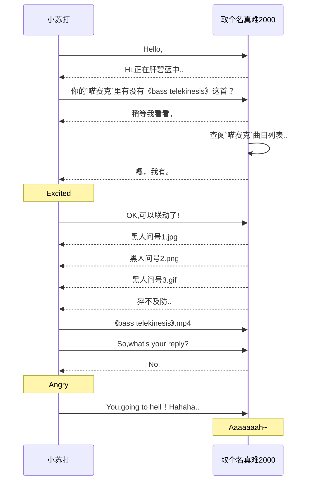

# 2019-04-25【木】

$\color{#00A0C1}{【难度】★☆}$

Today is a Sunny Day. 困扰我多天的一个， 不，两个问题终于解决了~ 其中一个问题就是难度表的颜色~ 参考了LATEX语法格式后， 我才发现原来要加上代码块的标识符， 另外一个问题， 我就用下面这个例子演示一遍， 依然是之前那个例子：

当然这只是一个例子，并非真实情况
***
不幸的事发生了，同事 $\color{#8A2BE2}\text{小宇}$ 今早去医院做了各项检查，下午过来后收拾东西打算回ChongQing做手术，居然这么突然，据他索说，20天前便出现了征兆，昨天实在受不了，结果今天检察后才知道已经很严重了，恐怕今后是干不了这一行了，准备转行经商。这么一说，a&sup2;不禁开始反思起莱，身体才是硬件，不管技术再优秀，都是软体，都是没用的，医生还对 $\color{#8A2BE2}\text{小宇}$ 说，你这么年轻就已经这样了，再过不久链路也走不动了，看来确实挺严重的，今后只能有缘再见咯~
***
于是整个下午a&sup2;就在整李申请资料，中途需要打印申请表，拿出了快要落满灰尘的U pan，万万没想到不管哪个USB街口都无法写入数据，万般无奈之下只好进行了格式化，顺便修改了文件系统(๑乛◡乛๑) 格式化完毕后瞬间就能正常读写数据了,心情复杂~ 
***
不知不觉四月也快结束咯~ 今天的气温居然高达89.6℉， 这还没到五月呢， 难道说是夏天来临的蒸兆？ 希望雨季也快点降临吧~
***

Lanota更新，于是a&sup2;又把Deemo装回来了，果然还是低速适合我(๑乛◡乛๑)

已折叠多张图片

***
第一次得到两张彩色图纸，后来才知道装备图纸需要集齐50张才能合成，这得到猴年马月了。。。 

***

今天再来测试一下gif动图的效果： 
